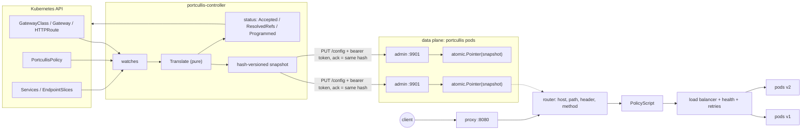

# Portcullis

**An L7 reverse proxy, a safe policy language, and a Kubernetes Gateway API controller, written from scratch in Go. Every number in this README is measured, and every gap is written down.**

- **`portcullis`**, the *data plane*: a reverse proxy and load balancer. It has hand-written load balancing, health checks, budgeted retries, WebSockets, HTTP/2, TLS and atomic hot reload.
- **PolicyScript**: a small, sandboxed rule language, inspired by F5 iRules, that the proxy runs on every request and response.
- **`portcullis-controller`**, the *control plane*: it reads Gateway API resources and a `PortcullisPolicy` CRD, and programs every data-plane pod with a hash-acknowledged config snapshot.

```text
policy "edge-rules" {
  on request {
    if path.starts_with("/admin") && !(client.ip in ["10.0.0.0/8", "192.168.0.0/16"]) {
      deny(403, "admin is internal only")
    }
    if header("user-agent").contains("sqlmap") { deny(403) }
    if rate_limit(client.ip, 100, "1m") { deny(429) }
    if header("x-canary") == "1" { route_to("canary") }
    set_header("x-frame-options", "DENY")
  }
  on response {
    remove_header("server")
  }
}
```

## Architecture



A request loads the current snapshot once and keeps it for its whole life, retries included. A new config is validated and compiled in full before one pointer swap, so a bad config never serves traffic (ADR 0007).

## Quickstart

Requires Go 1.27+, GNU make and Docker; `make demo` also needs kubectl. Nothing is installed globally: `make tools` builds kind and vegeta into `bin/tools/`.

**On your machine:**

```sh
make build
./bin/portcullis -upstream http://127.0.0.1:9000,http://127.0.0.1:9001 -lb p2c   # proxy :8080, admin 127.0.0.1:9901
./bin/portcullis -config docs/examples/portcullis.yaml       # full config with a policy; `kill -HUP` reloads it
curl -X PUT --data-binary @new.yaml 127.0.0.1:9901/config     # or push a new config to the admin API
```

**On Kubernetes (kind):**

```sh
make demo          # cluster, CRDs, controller, 2 data-plane pods, app v1+v2; shows canary, policy, failover
make e2e           # end-to-end tests of the same behaviours
make conformance   # upstream Gateway API conformance suite, in the cluster
deploy/record-demo.sh   # paced walk-through for `asciinema rec -c deploy/record-demo.sh`
make demo-down
```

**Development:** `make all` (lint, tests with `-race`, build), `make vuln`, `make fuzz`, `make bench` (about an hour; needs a quiet machine), `make help`.

## Results

All results are from one Apple M1 laptop running everything in Docker; see [docs/BENCHMARKS.md](docs/BENCHMARKS.md) for the method, raw data and limitations.

| What | Result |
|---|---|
| Keep-alive throughput, 16–256 connections | the load generator is the ceiling (about 13k req/s direct); all three proxies reach 75–80% of direct |
| CPU per 1k req/s | Portcullis 7.6–8.2, `httputil.ReverseProxy` 8.1–9.2, NGINX 5.6–5.9 (**NGINX 22–31% cheaper**) |
| p99 at 256 connections | Portcullis 8.7 ms, `httputil` 20.8 ms, NGINX 0.9 ms |
| Backend killed under 1,000 req/s (3 runs) | **0 failed requests of 89,990**; re-admitted in 240–464 ms (NGINX: 0 failed, 1.2–1.8 s) |
| 100 config reloads under load (10 invalid) | **0 failed requests** |
| PolicyScript, 5-rule example | **372 ns, 1 allocation**; fuzzed for 9.6M executions with no failures |
| Kubernetes demo (`make e2e`) | 90/10 canary 450/50 of 500; 399/399 requests succeed while every v1 pod is deleted |
| Gateway API conformance | see [docs/CONFORMANCE.md](docs/CONFORMANCE.md) |

## Design decisions

| Decision | Why | ADR |
|---|---|---|
| Immutable config snapshot, one atomic swap | a reload can never half-apply; in-flight requests finish on the snapshot they started with | [0007](docs/adr/0007-config-snapshots-and-hot-reload.md) |
| Per-read and per-write idle deadlines, not whole-request timeouts | long downloads and WebSockets stay alive while stalled peers are cut | [0004](docs/adr/0004-idle-deadlines-instead-of-whole-request-timeouts.md) |
| Retries only for idempotent requests, inside a token-bucket budget | retries must not turn a partial outage into a full one | [0005](docs/adr/0005-retry-rules.md) |
| Panic mode on by default | when most of a pool looks unhealthy, the health checks are more likely wrong than the pool | [0009](docs/adr/0009-panic-mode-on-by-default.md) |
| PolicyScript has no loops, no I/O, and step and time budgets | a policy written by a namespace user must not be able to hang or attack the proxy | [0010](docs/adr/0010-policyscript-design.md) |
| Rate limits are per instance, divided by the replica count | no shared store on the request path; approximate by design | [0011](docs/adr/0011-policy-gaps-closed.md) |
| Controller: one work-queue key, full rebuild, pure `Translate` | every data plane always gets one consistent snapshot; semantics unit-tested without a cluster | [0012](docs/adr/0012-controller-design.md) |
| Unsupported Gateway API features are rejected with a reason, not approximated | serving a route without its header filter would be silently wrong | [0012](docs/adr/0012-controller-design.md) |

All ADRs are in [docs/adr/](docs/adr/). The threat model is [docs/SECURITY.md](docs/SECURITY.md); what is not built yet is [docs/ROADMAP.md](docs/ROADMAP.md).

## Layout

| Path | Contents |
|---|---|
| `cmd/portcullis`, `cmd/portcullis-controller` | binaries |
| `internal/{proxy,lb,health,config,policy,ratelimit,metrics,admin,controller}` | one package per concern |
| `bench/` | benchmark harness and raw results |
| `deploy/` | Dockerfile, kind config, manifests, demo and conformance scripts |
| `test/{integration,e2e,conformance}` | tests that span packages or need a cluster |
| `docs/` | design, ADRs, policy language, benchmarks, security, conformance, interview notes |
