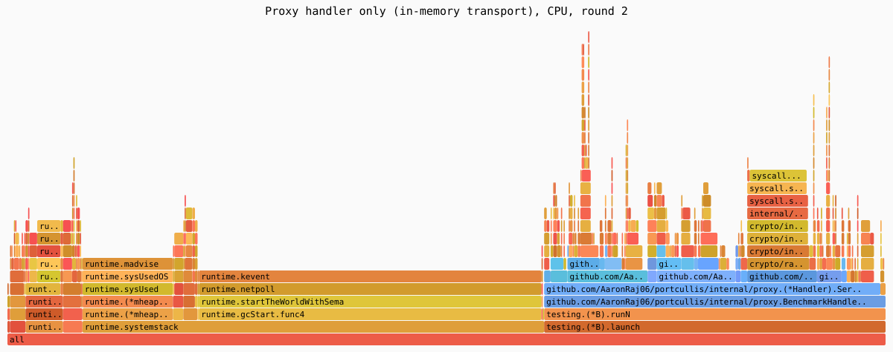

# Benchmarks

Everything here was measured on one laptop. Read the **Limitations** section before quoting a number.

## Environment

| | |
|---|---|
| Machine | Apple M1 (4 performance + 4 efficiency cores), 8 GB RAM, macOS |
| Docker | Docker Desktop 4.99, engine 29.9.3, Linux VM with 8 vCPUs / 4 GB |
| Go | 1.26 in the images (bench image `golang:1.26`), 1.27.4 on the host for micro-benchmarks |
| NGINX | `nginx:1.27.5-alpine` (official image) |
| Load generator | vegeta v12.13.0, run in a container |
| Commit | see `meta.json` in each results directory |

## Methodology

Run `make bench` (full matrix, about an hour) or `make bench-quick` (one short run, for development). The harness is `bench/run`.

**Targets.** All four answer the same request (`GET /small`, a 128-byte body, or `GET /large`, 256 KiB) from the same backend (`bench/backend`):

| Target | What |
|---|---|
| `direct` | the backend itself; the ceiling for everything else |
| `portcullis` | this project, `bench/portcullis.yaml` (one route, one pool, retries on, access log off) |
| `httputil` | Go's `httputil.ReverseProxy` with the **same `http.Transport` settings** as Portcullis (`bench/rproxy`) |
| `nginx` | NGINX as a reverse proxy: HTTP/1.1 keep-alive upstream pool, `X-Forwarded-For`, access log off (`bench/nginx/nginx.conf`) |

**Fairness controls.**
- **CPU pinning.** `--cpuset-cpus` puts the load generator on vCPUs 0–2, the proxy under test on vCPU 3 alone, and the backends on vCPUs 4–5. vCPUs 6–7 are left for Docker and the VM. Nothing shares a core. With one core per proxy, the proxy should be the bottleneck. NGINX runs `worker_processes 1`; Go sets `GOMAXPROCS=1` from the CPU set automatically.
- **Same network path.** All containers share the Docker VM's network namespace (`--network host`) and talk over loopback. A first attempt on a Docker bridge network capped *every* target, including the bare backend, at about 12–13k req/s.
- **Same logging.** Access logs are off for every proxy, so the comparison is proxying work, not log formatting.
- **Interleaving.** Within each scenario the runs go A B C D, A B C D, …, so slow drift on the host (thermal throttling, a background task) hits every target alike.
- **Warm-up.** Each target gets a discarded 2-second warm-up per scenario (connection pools, CPU caches).

**Load shapes.**
- **Throughput (closed loop):** vegeta `-rate=0 -workers=C` keeps C requests in flight. C = 16, 64, 256, with keep-alive on and off for `/small`; C = 16, 64 for `/large`.
- **Latency (open loop):** a fixed arrival rate (1,000 and 4,000 req/s for `/small`, 500 req/s for `/large`). Requests are sent on schedule even when earlier ones are slow, so a stall shows up in the percentiles instead of silently lowering the request rate. This avoids *coordinated omission*.
- **Failure injection:** 1,000 req/s for 30 s against a two-backend pool. At t = 10 s one backend stops accepting connections (`SIGUSR1` closes its listener, like a crashed process); at t = 20 s it comes back. Portcullis (passive ejection after 1 failure, 5 s ejection, active checks every 1 s, retries) is compared with NGINX (`max_fails=1 fail_timeout=5s`, `proxy_next_upstream error` by default).

**Statistics.** 5 runs of 10 s per scenario and target (3 runs for failure injection). Medians are reported with min–max spread. CPU is the mean of `docker stats` samples (100% = one core); memory is the peak. **CPU %/1k req/s** is CPU per thousand requests per second: the cost of proxying, comparable even when targets serve different rates.

**Raw data.** Each results directory has `meta.json` (settings, host, commit), `results.json` (every run), `summary.{md,csv,json}` (medians), `failover.json`, and `raw/` with vegeta's full JSON report for every run plus the `docker stats` samples. Per-request vegeta binaries are kept only for failure injection (needed for per-second error counts). For the rest they would need gigabytes, and the laptop had about 3 GB free.

## Optimisation rounds (Go micro-benchmarks)

Measured with `go test -bench Handler -benchmem -count 6` (`internal/proxy/bench_test.go`, an in-memory transport, so only proxy code and `net/http` server types are counted) and `BenchmarkEndToEnd` (`test/integration/bench_test.go`, real loopback TCP: client → proxy → backend). Raw output: `bench/results/profiles/round{0,1,2}.txt`. Medians of 6:

| Benchmark | Round 0 | Round 1 | Round 2 | Change |
|---|--:|--:|--:|--:|
| Handler, bare: allocs/op | 31 | 21 | **17** | −45% |
| Handler, bare: ns/op | 3,244 | 2,755 | **2,352** | −27% |
| Handler, bare: B/op | 2,292 | 2,164 | **1,661** | −28% |
| Handler, default config (metrics + retries): allocs/op | 35 | 25 | **18** | −49% |
| Handler, default config: ns/op | 3,678 | 3,113 | **2,683** | −27% |
| End-to-end over loopback: allocs/op (client + proxy + backend) | 161 | 151 | **147** | −9% |

7 of the 17 remaining handler allocations belong to the in-memory test transport, not to the proxy.

- **Round 0 → 1: header and string work.**
  - Turn the peer IP into a string once instead of three times.
  - Use shared read-only slices for constant header values (`X-Forwarded-Proto`, `Via`, an empty `User-Agent`), each with capacity = length so an append copies instead of writing into the shared array.
  - Give the three per-request values (`X-Forwarded-For`, `X-Forwarded-Host`, the request ID) one backing array, and send the same request-ID slice to the upstream and back to the client.
  - Skip building access-log attributes when the log level drops them.
- **Round 1 → 2: request copies.**
  - Build the upstream header map in one pass that skips hop-by-hop headers, instead of `Header.Clone` followed by deletions.
  - Make the outbound request with one shallow copy of the inbound one, which carries its context, instead of a literal plus `WithContext`.
  - Use the template directly for the first attempt, so only an actual retry copies.
  - Replace the `httptrace` write hook for retry safety with "the dial failed" (ADR 0005 update), which removed four allocations from every retry-eligible request.

### What the profiles say

In the end-to-end CPU profile (`bench/results/profiles/cpu-e2e-round2.prof`), **67% of samples are in `read`/`write` system calls** and another ~20% in the Go scheduler (parking, waking, `kevent`). `Handler.ServeHTTP` is **1.3%** cumulative. On this machine a proxied request costs mostly kernel I/O and `net/http`'s connection handling. The rounds above make the proxy's own share smaller and lighter on the garbage collector, but they **do not change end-to-end latency much**, and the end-to-end benchmark's wall-clock time was too noisy (42–58 µs across runs) to claim a speed-up from it. Allocations are the reliable signal there.

Proxy handler only, before and after (`flame-cpu-handler-round0.svg`, `flame-cpu-handler-round2.svg`; Portcullis frames are blue):

Flame graphs are rendered by `bench/flame` from `go tool pprof -traces` (no graphviz needed): `go tool pprof -traces BIN PROFILE | go run ./bench/flame -title T > out.svg`.
