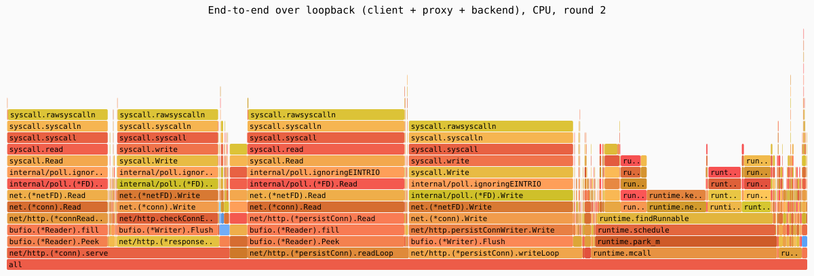
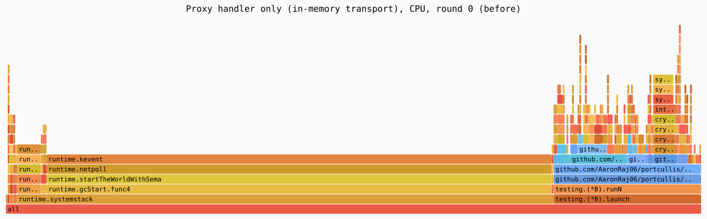

# Benchmarks

Everything here was measured on one laptop. Read the **Limitations** section before quoting a number.

## Environment

| | |
|---|---|
| Machine | Apple M1 (4 performance + 4 efficiency cores), 8 GB RAM, macOS |
| Docker | Docker Desktop 4.99, engine 29.9.3, Linux VM with 8 vCPUs / 4 GB |
| Go | 1.26 in the images (bench image `golang:1.26`), 1.27.4 on the host for micro-benchmarks |
| NGINX | `nginx:1.27.5-alpine` (official image) |
| Load generator | vegeta v12.13.0, run in a container |
| Commit | see `meta.json` in each results directory |

## Methodology

Run `make bench` (full matrix, about an hour) or `make bench-quick` (one short run, for development). The harness is `bench/run`.

**Targets.** All four answer the same request (`GET /small`, a 128-byte body, or `GET /large`, 256 KiB) from the same backend (`bench/backend`):

| Target | What |
|---|---|
| `direct` | the backend itself; the ceiling for everything else |
| `portcullis` | this project, `bench/portcullis.yaml` (one route, one pool, retries on, access log off) |
| `httputil` | Go's `httputil.ReverseProxy` with the **same `http.Transport` settings** as Portcullis (`bench/rproxy`) |
| `nginx` | NGINX as a reverse proxy: HTTP/1.1 keep-alive upstream pool, `X-Forwarded-For`, access log off (`bench/nginx/nginx.conf`) |

**Fairness controls.**
- **CPU pinning.** `--cpuset-cpus` puts the load generator on vCPUs 0–2, the proxy under test on vCPU 3 alone, and the backends on vCPUs 4–5. vCPUs 6–7 are left for Docker and the VM. Nothing shares a core. With one core per proxy, the proxy should be the bottleneck. NGINX runs `worker_processes 1`; Go sets `GOMAXPROCS=1` from the CPU set automatically.
- **Same network path.** All containers share the Docker VM's network namespace (`--network host`) and talk over loopback. A first attempt on a Docker bridge network capped *every* target, including the bare backend, at about 12–13k req/s.
- **Same logging.** Access logs are off for every proxy, so the comparison is proxying work, not log formatting.
- **Interleaving.** Within each scenario the runs go A B C D, A B C D, …, so slow drift on the host (thermal throttling, a background task) hits every target alike.
- **Warm-up.** Each target gets a discarded 2-second warm-up per scenario (connection pools, CPU caches).

**Load shapes.**
- **Throughput (closed loop):** vegeta `-rate=0 -workers=C` keeps C requests in flight. C = 16, 64, 256, with keep-alive on and off for `/small`; C = 16, 64 for `/large`.
- **Latency (open loop):** a fixed arrival rate (1,000 and 4,000 req/s for `/small`, 500 req/s for `/large`). Requests are sent on schedule even when earlier ones are slow, so a stall shows up in the percentiles instead of silently lowering the request rate. This avoids *coordinated omission*.
- **Failure injection:** 1,000 req/s for 30 s against a two-backend pool. At t = 10 s one backend stops accepting connections (`SIGUSR1` closes its listener, like a crashed process); at t = 20 s it comes back. Portcullis (passive ejection after 1 failure, 5 s ejection, active checks every 1 s, retries) is compared with NGINX (`max_fails=1 fail_timeout=5s`, `proxy_next_upstream error` by default).

**Statistics.** 5 runs of 10 s per scenario and target (3 runs for failure injection). Medians are reported with min–max spread. CPU is the mean of `docker stats` samples (100% = one core); memory is the peak. **CPU %/1k req/s** is CPU per thousand requests per second: the cost of proxying, comparable even when targets serve different rates.

**Raw data.** Each results directory has `meta.json` (settings, host, commit), `results.json` (every run), `summary.{md,csv,json}` (medians), `failover.json`, and `raw/` with vegeta's full JSON report for every run plus the `docker stats` samples. Per-request vegeta binaries are kept only for failure injection (needed for per-second error counts). For the rest they would need gigabytes, and the laptop had about 3 GB free.

## Optimisation rounds (Go micro-benchmarks)

Measured with `go test -bench Handler -benchmem -count 6` (`internal/proxy/bench_test.go`, an in-memory transport, so only proxy code and `net/http` server types are counted) and `BenchmarkEndToEnd` (`test/integration/bench_test.go`, real loopback TCP: client → proxy → backend). Raw output: `bench/results/profiles/round{0,1,2}.txt`. Medians of 6:

| Benchmark | Round 0 | Round 1 | Round 2 | Change |
|---|--:|--:|--:|--:|
| Handler, bare: allocs/op | 31 | 21 | **17** | −45% |
| Handler, bare: ns/op | 3,244 | 2,755 | **2,352** | −27% |
| Handler, bare: B/op | 2,292 | 2,164 | **1,661** | −28% |
| Handler, default config (metrics + retries): allocs/op | 35 | 25 | **18** | −49% |
| Handler, default config: ns/op | 3,678 | 3,113 | **2,683** | −27% |
| End-to-end over loopback: allocs/op (client + proxy + backend) | 161 | 151 | **147** | −9% |

7 of the 17 remaining handler allocations belong to the in-memory test transport, not to the proxy.

- **Round 0 → 1: header and string work.**
  - Turn the peer IP into a string once instead of three times.
  - Use shared read-only slices for constant header values (`X-Forwarded-Proto`, `Via`, an empty `User-Agent`), each with capacity = length so an append copies instead of writing into the shared array.
  - Give the three per-request values (`X-Forwarded-For`, `X-Forwarded-Host`, the request ID) one backing array, and send the same request-ID slice to the upstream and back to the client.
  - Skip building access-log attributes when the log level drops them.
- **Round 1 → 2: request copies.**
  - Build the upstream header map in one pass that skips hop-by-hop headers, instead of `Header.Clone` followed by deletions.
  - Make the outbound request with one shallow copy of the inbound one, which carries its context, instead of a literal plus `WithContext`.
  - Use the template directly for the first attempt, so only an actual retry copies.
  - Replace the `httptrace` write hook for retry safety with "the dial failed" (ADR 0005 update), which removed four allocations from every retry-eligible request.

### What the profiles say

In the end-to-end CPU profile (`bench/results/profiles/cpu-e2e-round2.prof`), **67% of samples are in `read`/`write` system calls** and another ~20% in the Go scheduler (parking, waking, `kevent`). `Handler.ServeHTTP` is **1.3%** cumulative. On this machine a proxied request costs mostly kernel I/O and `net/http`'s connection handling. The rounds above make the proxy's own share smaller and lighter on the garbage collector, but they **do not change end-to-end latency much**, and the end-to-end benchmark's wall-clock time was too noisy (42–58 µs across runs) to claim a speed-up from it. Allocations are the reliable signal there.

Proxy handler only, before and after (`flame-cpu-handler-round0.svg`, `flame-cpu-handler-round2.svg`; Portcullis frames are blue):

Flame graphs are rendered by `bench/flame` from `go tool pprof -traces` (no graphviz needed): `go tool pprof -traces BIN PROFILE | go run ./bench/flame -title T > out.svg`.

## Load-test results (run of 2026-11-20)

Raw data: [`bench/results/2026-11-20/`](../bench/results/2026-11-20/) (commit `b2fab26`; full table in `summary.md`, every run in `results.json`, vegeta reports in `raw/`).

**Read this first: the host was busy.** Other applications were running during this run, and the Mac's 1-minute load average (recorded per run as `host_load1`) was between **3.3 and 65** on 8 cores, with a median of 7.7. The harness waits for a quiet host before it starts but cannot pause mid-run. So:

- **Keep-alive throughput (load 4.7–9.1)** is usable. All four targets ran interleaved under the same conditions, and the spreads are tight. These are the numbers below.
- **Open-loop latency (load 6.8–49.6)** is **not usable**. Tails jump between runs for *every* target: NGINX's p99 at 4,000 req/s ranges from 1.5 ms to 422 ms. These rows are in `summary.md` but are not quoted here.
- **Keep-alive off** hit a harness defect (see Limitations) and is not usable either.
- **Failure injection** measures errors and timings of seconds, not milliseconds, so it holds up under noise.

Earlier attempts that day were discarded and not committed: the Docker VM's disk filled up, and later a Docker engine 500 aborted a run. The harness now stops below 3 GiB of free disk and retries transient engine errors.

### Throughput, keep-alive on, `GET /small` (median of 5, min–max)

| Concurrency | Target | req/s | p99 ms | CPU %/1k req/s | Peak memory |
|---|---|--:|--:|--:|--:|
| 16 | direct | 12,697 (12,018–13,171) | 0.33 | 5.7 | 12 MiB |
| 16 | **portcullis** | **10,079** (9,308–10,462) | 1.51 | **7.6** | 13 MiB |
| 16 | httputil | 9,829 (8,759–10,636) | 1.50 | 8.1 | 12 MiB |
| 16 | nginx | 10,374 (9,279–11,077) | 0.65 | 5.9 | 5 MiB |
| 64 | direct | 12,267 | 0.39 | 6.0 | 16 MiB |
| 64 | **portcullis** | **9,529** | 2.61 | **8.2** | 13 MiB |
| 64 | httputil | 9,609 | 2.80 | 9.1 | 17 MiB |
| 64 | nginx | 10,596 | 0.72 | 5.7 | 5 MiB |
| 256 | direct | 13,049 | 0.54 | 5.7 | 39 MiB |
| 256 | **portcullis** | **9,756** | 8.70 | **8.1** | 35 MiB |
| 256 | httputil | 9,613 | 20.78 | 9.2 | 35 MiB |
| 256 | nginx | 10,384 | 0.90 | 5.6 | 6 MiB |

What this shows:

- **The load generator is the ceiling, not the proxies.** The bare backend tops out at about 12–13k req/s at every concurrency, and the three proxies all land within about 10% of each other, at 75–80% of direct. So raw req/s here mostly measures vegeta on 3 vCPUs. **CPU per 1k req/s** is the fairer comparison, because it is the cost of proxying whatever rate was achieved.
- **Portcullis vs `httputil.ReverseProxy`:** about **6–12% less CPU per request**, with the same throughput, and a lower p99 at 256 connections (8.7 vs 20.8 ms). Both use the same `http.Transport` settings, so the difference is the handler work from the optimisation rounds above, even though Portcullis also does routing, health state, retries and metrics.
- **Where NGINX wins (clearly):**
  - **CPU:** NGINX needs **22–31% less CPU per request** than Portcullis (5.6–5.9 vs 7.6–8.2).
  - **Tail latency:** NGINX's p99 stays under 1 ms at every concurrency. Portcullis goes from 1.5 ms to 8.7 ms as connections grow. One core shared by hundreds of goroutines, the Go scheduler and the garbage collector costs tail latency that an event loop in C does not pay.
  - **Memory:** NGINX uses about 5 MiB against 13–35 MiB for Portcullis.

  Matching NGINX was never the goal. Portcullis is a few thousand lines of Go with hand-written load balancing, and every piece of it can be explained.

`/large` (256 KiB) throughput ran at load averages up to 60 and has 2–10× min–max spreads, so it is not compared here.

### Failure injection (3 runs each, 1,000 req/s, one of two backends dies at t = 10 s and comes back at t = 20 s)

| Target | Failed requests | Re-admission after the backend returns |
|---|--:|--:|
| **portcullis** | **0 / 89,990** in all 3 runs | **240–464 ms** |
| nginx | 0 / 90,000 in all 3 runs | 1,209–1,825 ms |

- Neither proxy dropped a request. Portcullis retries an idempotent request on another backend when the dial fails (ADR 0005), and NGINX's `proxy_next_upstream error` does the same.
- Portcullis takes the backend back sooner, because its active health check runs every second, while NGINX waits out `fail_timeout`.
- An earlier run at the same settings, with panic mode *off*, returned **10.3% errors** (2,559 of 24,871), all `503 no available backend`, for about 5 seconds. The host stalled (load above 100), both health checkers timed out together, and they marked *both* healthy backends down. That evidence led to ADR 0009 (panic mode on by default). The log is in `bench/results/evidence/adr-0009-failover-run.txt`.

## Limitations

- **One laptop, everything on it.** The load generator, proxies and backends share one Docker VM on one M1. Pinning to separate vCPUs prevents direct sharing, but macOS still schedules those vCPUs alongside everything else on the Mac. This run was made on a busy host (see above). A clean re-run needs a quiet machine: `make bench`, then check the `host load (max)` column that `summary.md` now includes.
- **Keep-alive-off runs are broken by a harness defect, not yet fixed.** In those runs, every vegeta worker had exactly one request that hung until the 10 s client timeout. The pattern was the same for direct, Portcullis, `httputil` and NGINX, but it hit different targets in different runs, which points at the VM's TCP stack rather than at any proxy. The suspected cause is socket state left by tens of thousands of short-lived loopback connections between interleaved targets. TIME_WAIT is only drained between *scenarios*, not between targets. Recorded in `docs/ROADMAP.md`.
- **The generator caps throughput** at about 13k req/s, so the maximum throughput of a single proxy core is not measured. CPU per request is.
- **Loopback only.** No real network latency or packet loss, and no TLS in these runs.
- **10-second runs.** Long enough for stable medians on a quiet host. Too short to show slow leaks or GC behaviour over minutes.
